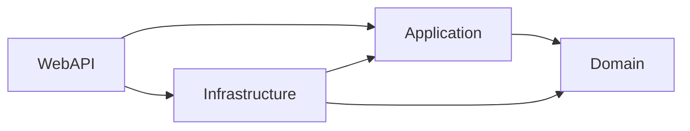

# Architecture Testing in .NET for DDD with NetArchTest

A solution can have the right folders and still have the wrong dependencies. An `Order` entity starts using `HttpClient`, a command handler reaches for an EF Core `DbContext`, and the business model gradually becomes harder to test on its own.

**Architecture tests turn selected design decisions into executable checks.** This guide adds three practical NetArchTest rules to the layering used in the [Clean Architecture + CQRS template](Clean-Architecture-Template.md): protect the Domain, check repository dependencies, and keep Application independent of implementation details.

The examples use `YourApp` and an `Order` aggregate as placeholders. They target **.NET 10, xUnit v2, and `NetArchTest.Rules` 1.3.2**. Replace project and namespace names with your own. These are rules for this architecture, not a universal definition of Domain-Driven Design (DDD).

---

## 1. Decide what the tests should protect

DDD centers the model on business concepts and behavior. Clean Architecture supplies a dependency structure that can help protect that model. Passing a layering test cannot tell you whether you chose the right aggregate boundaries or implemented the right business rules.

For this guide, the intended compile-time dependencies are:



An arrow means **references**, not the direction of a runtime request. WebAPI may reference Infrastructure to register implementations in the composition root.

| Layer | Responsibility | Boundary to protect |
| --- | --- | --- |
| Domain | Aggregates, entities, value objects, domain behavior | No dependency on outer layers, persistence, or HTTP clients |
| Application | Use cases, handlers, DTOs, repository/service contracts | Use abstractions; do not depend on Infrastructure or WebAPI |
| Infrastructure | Persistence and external service implementations | Implement inner-layer contracts and persist domain objects |
| WebAPI | Endpoints, middleware, dependency injection wiring | Keep business decisions in the inner layers |

The existing template puts repository interfaces in **Application**. This guide preserves that choice. Another common DDD design puts aggregate repository interfaces in **Domain**; either way, their implementations belong outside the business model. For aggregate writes, design repositories around aggregate roots rather than automatically creating one for every database table. Microsoft discusses these choices in its [DDD persistence guidance](https://learn.microsoft.com/en-us/dotnet/architecture/microservices/microservice-ddd-cqrs-patterns/infrastructure-persistence-layer-design).

## 2. Set up a dedicated test project

Assume the production projects already follow the template. Add one test project alongside them:

```text
YourApp.Domain/
YourApp.Application/
YourApp.Infrastructure/
YourApp.WebAPI/
YourApp.ArchitectureTests/
```

Run these commands from the solution directory:

```bash
dotnet new xunit -n YourApp.ArchitectureTests --framework net10.0
dotnet add YourApp.ArchitectureTests package NetArchTest.Rules --version 1.3.2
dotnet add YourApp.ArchitectureTests reference YourApp.Domain/YourApp.Domain.csproj
dotnet add YourApp.ArchitectureTests reference YourApp.Application/YourApp.Application.csproj
dotnet add YourApp.ArchitectureTests reference YourApp.Infrastructure/YourApp.Infrastructure.csproj
```

If the solution has a `.sln` or `.slnx` file, add the test project to that actual file as well. Keep the production project references unchanged; the test project references the assemblies it inspects, and production projects never reference the tests.

### Select assemblies explicitly

Add a public marker in each inspected production project. Each block below is a separate file:

```csharp
// YourApp.Domain/AssemblyMarker.cs
namespace YourApp.Domain;

public static class AssemblyMarker { }
```

```csharp
// YourApp.Application/AssemblyMarker.cs
namespace YourApp.Application;

public static class AssemblyMarker { }
```

```csharp
// YourApp.Infrastructure/AssemblyMarker.cs
namespace YourApp.Infrastructure;

public static class AssemblyMarker { }
```

`Types.InAssembly(...)` takes a `System.Reflection.Assembly`, so use `typeof(AssemblyMarker).Assembly`. Passing a project-name string such as `Types.InAssembly("YourApp.Domain")` does not compile with this API. Explicit assembly selection also avoids relying on whichever assemblies happen to be loaded in the test runner. See the [NetArchTest API source](https://github.com/BenMorris/NetArchTest/blob/v1.3.2/src/NetArchTest.Rules/Types.cs).

### Make failures useful

Add this helper to the test project. It includes the offending type names in the assertion message:

```csharp
// YourApp.ArchitectureTests/ArchitectureAssert.cs
using System;
using NetArchTest.Rules;
using Xunit;

namespace YourApp.ArchitectureTests;

internal static class ArchitectureAssert
{
    public static void Pass(TestResult result, string rule)
    {
        var failingTypes = result.FailingTypeNames ?? Array.Empty<string>();

        Assert.True(
            result.IsSuccessful,
            $"{rule}{Environment.NewLine}Failing types: " +
            string.Join(", ", failingTypes));
    }
}
```

`FailingTypeNames` reports names without asking NetArchTest to load each failing type through reflection. This is useful when diagnosing dependency-loading problems; see the [result API](https://github.com/BenMorris/NetArchTest/blob/v1.3.2/src/NetArchTest.Rules/TestResult.cs).

## 3. Example one — keep Domain independent of outer layers

**Intent:** an aggregate should express business behavior without depending on an API endpoint, a database provider, or an HTTP client.

```csharp
// YourApp.ArchitectureTests/DomainDependencyTests.cs
using NetArchTest.Rules;
using Xunit;
using DomainMarker = YourApp.Domain.AssemblyMarker;

namespace YourApp.ArchitectureTests;

public sealed class DomainDependencyTests
{
    [Fact]
    public void Domain_should_not_depend_on_outer_layers_or_io_technologies()
    {
        var result = Types.InAssembly(typeof(DomainMarker).Assembly)
            .ShouldNot()
            .HaveDependencyOnAny(
                "YourApp.Application",
                "YourApp.Infrastructure",
                "YourApp.WebAPI",
                "Microsoft.EntityFrameworkCore",
                "Microsoft.AspNetCore",
                "System.Data",
                "System.Net.Http")
            .GetResult();

        ArchitectureAssert.Pass(result,
            "Domain must not depend on outer layers or the listed I/O technologies.");
    }
}
```

There is deliberately no `AreClasses()` filter: domain interfaces and value types can leak dependencies too. For example, an interface exposing `HttpClient` is still an architectural dependency even if no domain class constructs it.

**Try breaking it:** add a public `System.Net.Http.HttpClient` property to a Domain type. This test should fail and name that type. Remove the property, move HTTP work to Infrastructure, and expose an appropriate application-facing contract if the use case needs it.

This is a **denylist**, not proof that Domain has no external dependencies. It checks the listed namespaces/types; an unlisted vendor SDK can still slip through. Maintain the list deliberately, and inspect project/package references separately if the team requires zero project references or a strict package allowlist.

## 4. Example two — make repository dependencies explicit

**Intent:** concrete repositories in this application persist domain objects. A class called `OrderRepository` that only moves unrelated transport DTOs may be hiding a different responsibility.

```csharp
// YourApp.ArchitectureTests/RepositoryDependencyTests.cs
using NetArchTest.Rules;
using Xunit;
using InfrastructureMarker = YourApp.Infrastructure.AssemblyMarker;

namespace YourApp.ArchitectureTests;

public sealed class RepositoryDependencyTests
{
    [Fact]
    public void Concrete_repositories_should_depend_on_domain()
    {
        var repositories = Types
            .InAssembly(typeof(InfrastructureMarker).Assembly)
            .That().AreClasses()
            .And().AreNotAbstract()
            .And().HaveNameEndingWith("Repository");

        Assert.NotEmpty(repositories.GetTypes());

        var result = repositories
            .Should()
            .HaveDependencyOn("YourApp.Domain")
            .GetResult();

        ArchitectureAssert.Pass(result,
            "Concrete repositories must reference domain types.");
    }
}
```

The non-empty assertion matters: a misspelled suffix or the wrong assembly must not make the test appear useful while inspecting nothing. This selector assumes **non-generic concrete classes ending in `Repository`**, consistent with the template's entity-specific implementations; abstract base repositories are excluded. Adjust the selector if your naming or generic conventions differ. A separate naming rule or explicit inventory is needed to catch one repository being renamed out of scope while other repositories still match.

For a small dependency example, these three files supply a domain type, an application contract, and a concrete implementation. Use existing types in a real application instead of duplicating them:

```csharp
// YourApp.Domain/Entities/Order.cs
namespace YourApp.Domain.Entities;

public sealed class Order
{
    public System.Guid Id { get; init; }
}
```

```csharp
// YourApp.Application/Common/Interfaces/IOrderRepository.cs
using System;
using System.Threading;
using System.Threading.Tasks;
using YourApp.Domain.Entities;

namespace YourApp.Application.Common.Interfaces;

public interface IOrderRepository
{
    Task<Order?> GetByIdAsync(Guid id, CancellationToken cancellationToken);
}
```

```csharp
// YourApp.Infrastructure/Data/Repositories/OrderRepository.cs
using System;
using System.Threading;
using System.Threading.Tasks;
using YourApp.Application.Common.Interfaces;
using YourApp.Domain.Entities;

namespace YourApp.Infrastructure.Data.Repositories;

public sealed class OrderRepository : IOrderRepository
{
    // A minimal in-memory adapter for demonstrating the dependency rule.
    private readonly Order _order = new() { Id = Guid.NewGuid() };

    public Task<Order?> GetByIdAsync(Guid id, CancellationToken cancellationToken)
    {
        cancellationToken.ThrowIfCancellationRequested();
        return Task.FromResult<Order?>(_order.Id == id ? _order : null);
    }
}
```

**Try breaking it:** in this isolated example, replace `OrderRepository` with a class of the same name that has no interface and only returns a `Guid`. It still matches the selector, but has no Domain dependency, so the rule fails.

This test establishes a dependency, **not correct repository design**. It does not prove that the class implements `IOrderRepository`, persists an aggregate correctly, or respects transactions. A meaningless reference to `Order` could satisfy it. Use contract checks where needed, domain behavior tests for invariants, and integration tests for persistence. Query-only CQRS readers that return projections may legitimately have no Domain dependency; give them an explicit convention such as `OrderReadService` instead of forcing this rule on them.

## 5. Example three — keep Application behind abstractions

**Intent:** a use case can orchestrate an aggregate through an application contract without reaching into persistence or transport implementations.

```csharp
// YourApp.ArchitectureTests/ApplicationDependencyTests.cs
using NetArchTest.Rules;
using Xunit;
using ApplicationMarker = YourApp.Application.AssemblyMarker;

namespace YourApp.ArchitectureTests;

public sealed class ApplicationDependencyTests
{
    [Fact]
    public void Application_should_not_depend_on_implementation_details()
    {
        var result = Types.InAssembly(typeof(ApplicationMarker).Assembly)
            .ShouldNot()
            .HaveDependencyOnAny(
                "YourApp.Infrastructure",
                "YourApp.WebAPI",
                "Microsoft.EntityFrameworkCore",
                "Microsoft.AspNetCore",
                "System.Data",
                "System.Net.Http")
            .GetResult();

        ArchitectureAssert.Pass(result,
            "Application must use inner-layer contracts instead of implementation details.");
    }
}
```

Scanning the whole Application assembly also covers interfaces and DTOs. An `IOrderRepository` that returns `DbSet<Order>` leaks EF Core even if every handler depends only on that interface.

**Try breaking it:** introduce an Application service that accepts `HttpClient` directly. The test should fail. In this architecture, move that adapter to Infrastructure and let the use case depend on an application-owned service interface. Likewise, an EF Core dependency should fail; `IOrderRepository` returning an `Order` is allowed.

Do not apply the same restriction indiscriminately to WebAPI: its composition root needs to register Infrastructure implementations. If you later protect controllers, select controller types rather than banning Infrastructure across the entire WebAPI assembly.

## 6. Verify the rules and run them in CI

Run the dedicated test project from the solution directory:

```bash
dotnet test YourApp.ArchitectureTests/YourApp.ArchitectureTests.csproj --configuration Release
```

The command restores and builds by default. Add it to the application's CI pipeline after installing the required .NET SDK. If CI runs the whole solution, ensure this project is included. These examples do not need a database or a running web server.

Before trusting a new rule, make one temporary violation at a time:

| Check | Temporary change | Expected result |
| --- | --- | --- |
| Domain boundary | Add a Domain property of type `HttpClient` | Example one fails and names the offending type |
| Repository dependency | Replace the sample repository with a same-named class containing only a `Guid` method | Example two fails |
| Application boundary | Add an Application service with an `HttpClient` constructor parameter | Example three fails |
| Selector coverage | Temporarily change the repository suffix selector to a name that matches nothing | The non-empty assertion fails |

Revert each temporary violation and confirm the suite is green again. A compilation error caused by a circular project reference is already useful protection, but it is not evidence that a NetArchTest assertion executed.

## 7. Avoid false confidence

- **Namespace names are not project names.** Dependency arguments identify namespaces or types. Use fully qualified names such as `YourApp.Domain`, not a bare `Domain` token. Keep the strings synchronized with namespace refactors; `nameof(AssemblyMarker)` would only produce `AssemblyMarker`.
- **Scan every relevant assembly.** In the multi-tenant template, repositories may live in `YourApp.Infrastructure.Tenant`. Add a marker and project reference for it, and use `Types.InAssemblies(new[] { typeof(InfrastructureMarker).Assembly, typeof(TenantInfrastructureMarker).Assembly })` for the repository rule. Its Domain/Application restrictions still need the actual namespaces used by those assemblies.
- **Understand the detection boundary.** NetArchTest examines compiled code. An unused project/package reference or unused `using` directive is not equivalent to a detected type dependency. It does not inspect DI registration correctness or establish every runtime/reflection dependency. Version 1.3.2 also checks string literals in dependency rules, so inspect a reported match before assuming it is a real type reference. See the [release notes](https://github.com/BenMorris/NetArchTest/releases/tag/v1.3.2).
- **Keep exceptions narrow.** For a legacy violation, document the reason and scope an exception to the specific type. Avoid excluding an entire namespace just to get a green build.
- **Keep business tests.** An architecture test can keep EF Core out of an aggregate. A domain unit test must still prove that the aggregate rejects an invalid state transition, and an integration test must prove that persistence works.

Start with rules the team can explain and defend. Keep them close to the code, review changes to the rules alongside production changes, and deliberately break each new rule once before relying on it.

## References

- [Clean Architecture + CQRS template in this repository](Clean-Architecture-Template.md)
- [NetArchTest documentation and examples](https://github.com/BenMorris/NetArchTest)
- [NetArchTest.Rules 1.3.2 on NuGet](https://www.nuget.org/packages/NetArchTest.Rules/1.3.2)
- [Microsoft: design the infrastructure persistence layer](https://learn.microsoft.com/en-us/dotnet/architecture/microservices/microservice-ddd-cqrs-patterns/infrastructure-persistence-layer-design)
